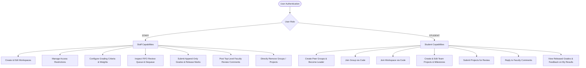
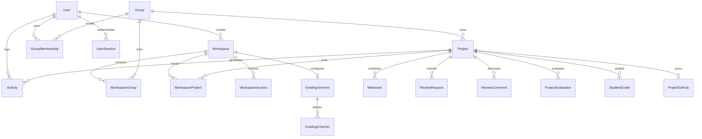

# MeshVault — Comprehensive Features & Codebase Inventory

**Document Generated**: September 28, 2026  
**Target Repository**: MeshVault (`d:\Meshvault`)  
**Scope**: Complete Architecture, Route & Page Breakdown, Interactive UI Elements, CRUD & API Mappings, Roles & Permissions, Global Systems, Data Models & UI/UX Audit.

---

## 1. Application Overview & Technology Stack

| Dimension | Specification | Details |
| :--- | :--- | :--- |
| **Application Name** | **MeshVault** | Academic Project Tracking, Evaluation & DSA Educational Platform |
| **Primary Purpose** | Specialized academic project management and evaluation platform designed for university computing courses (e.g., Data Structures & Algorithms). Features faculty gradebooks, peer teams, milestone tracking, GitHub repo sync, and custom memory-resident DSA algorithm engines. |
| **Frontend Framework** | **React 18** (v18.3.1) | Single-Page Application bootstrapped with **Vite** (v5.4.14) & `@vitejs/plugin-react` (v4.3.4) |
| **Routing** | **React Router DOM v6** (v6.26.2) | Client-side routing with `PrivateRoute` wrapper and role-based redirects |
| **UI Styling & Design System** | **Hybrid Styling**: Tailwind CSS (v3.4.17) + Custom Vanilla CSS Design System (`index.css`) + Inline Style Objects | Dark-mode focused (#09090b / #0c0c0e palette), custom badges, data tables, metrics strips, progress meters |
| **Iconography** | **Lucide React** (v1.42.0) + Unicode Emojis | Lucide icons in navigation/dashboard; emojis in buttons, section headers, badges |
| **State Management** | **React Context API** (`AuthContext.jsx`) + Local Component State (`useState`, `useEffect`, `useMemo`, `useCallback`) | Session token and user profile persisted in browser `localStorage` (`meshvault_session`) |
| **Backend Framework** | **FastAPI** (v0.138.0) | High-performance Python async REST API with custom lifespan startup rebuilding in-memory DSA data structures |
| **Server Engine** | **Uvicorn** (v0.49.0) | ASGI web server running on `http://localhost:8000` |
| **Database & ORM** | **SQLite** (`meshvault.db`) / **PostgreSQL** support via **SQLAlchemy 2.0** (v2.0.43) | 12 relational tables with foreign keys, cascading deletions, and uniqueness constraints |
| **Authentication & Security** | **Local Session Bearer Authentication** | Password hashing via **Bcrypt** (v5.0.0). Session tokens stored in `user_sessions` DB table. No third-party OAuth/JWT. |
| **Data Validation** | **Pydantic v2** (v2.12.4) | Pydantic Request/Response schemas with custom field validators |
| **DSA Engine (In-Memory)** | **Custom Python Algorithms** (`backend/dsa_engine.py`) | Hash-Table Smart Search (`ProjectSearchIndex`), Binary Search Tree (`ProgressBST`), FIFO Queue (`ReviewQueue`) |

---

## 2. Routes & Access Control Matrix

| Route Path | Page Component | Target Audience / Roles | Purpose & Functionality |
| :--- | :--- | :--- | :--- |
| `/login` | `pages/Login.jsx` | Public (Unauthenticated) | University portal sign-in form for faculty and students. |
| `/dashboard` | `pages/Dashboard.jsx` | Authenticated (`STAFF`, `STUDENT`) | Top-level KPI metrics strip, upcoming deadline schedule, activity audit stream, and student team roster. |
| `/workspace` | `pages/Workspace.jsx` | Authenticated (`STAFF`, `STUDENT`) | Multi-workspace switcher, course lab overview, student join modal, access control management, grading scheme configuration, and faculty Mark Registry (Gradebook). |
| `/workspace/new` | `pages/CreateWorkspace.jsx` | `STAFF` only | Wizard to establish a new academic course workspace with unique Workspace Code, Course Code, and Year. |
| `/groups` | `pages/Groups.jsx` | Authenticated (`STAFF`, `STUDENT`) | Group directory across courses. Students can create teams or join teams via unique Group Codes. |
| `/groups/:id` | `pages/GroupDetail.jsx` | Authenticated (`STAFF`, `STUDENT`) | Roster of leaders/members, workspace linkage, group projects, review request submissions, and group activity logs. |
| `/projects` | `pages/Projects.jsx` | Authenticated (`STAFF`, `STUDENT`) | Grid repository of all accessible academic projects with quick status badges and progress meters. |
| `/projects/new` | `pages/CreateProject.jsx` | `STUDENT` (Course Lab Groups) | New project creation wizard with manual Project ID input, priority, group binding, and initial status. |
| `/projects/:projectId` | `pages/ProjectDetail.jsx` | Authenticated (`STAFF`, `STUDENT`) | Detailed project dashboard: milestones, workspace-isolated comment discussions, GitHub repo sync, and per-student grading panel. |
| `/projects/:projectId/edit` | `pages/EditProject.jsx` | `STUDENT` (Group Members/Leaders) | Project parameter modification form (progress slider, status, priority, deadline) and project deletion. |
| `/search` | `pages/SmartSearch.jsx` | Authenticated (`STAFF`, `STUDENT`) | Real-time smart search engine powered by in-memory hash-table fragment indexing ($O(1)$ lookups). |
| `/profile` | `pages/Profile.jsx` | Authenticated (`STAFF`, `STUDENT`) | User account metadata, database primary key reference, university ID, and session sign-out. |
| `/my-grades` | `pages/MyGrades.jsx` | `STUDENT` only | Student report card showing all released evaluations, criterion breakdowns, evaluator feedback, and grade letter analytics ($A+, A, B, C, D, F$). |
| `/review-queue` | `pages/ReviewQueue.jsx` | `STAFF` only | FIFO Review Queue dashboard to inspect next pending student submission, evaluate criterion scores, and approve/dequeue. |
| `/progress-analytics` | `pages/ProgressAnalytics.jsx` | Authenticated (`STAFF`, `STUDENT`) | BST-powered progress explorer allowing range queries ($[min, max]$) with logarithmic search time. |
| `/audit-trail` | `pages/AuditTrail.jsx` | Authenticated (`STAFF`, `STUDENT`) | Chronological audit log of all system mutations (project creation, milestone additions, status transitions). |
| `/github` | `pages/GitHubSync.jsx` | Authenticated (`STAFF`, `STUDENT`) | Dedicated hub to connect, monitor, and explore commits, contributors, pull requests, and issues across linked GitHub repositories. |
| `/priority-engine` | `pages/Building.jsx` *(Placeholder route)* | Authenticated (`STAFF`, `STUDENT`) | Shows "Under Construction" banner. *(Note: Full `PriorityEngine.jsx` Min-Heap visualizer exists unlinked).* |
| `/sprint-optimizer` | `pages/Building.jsx` *(Placeholder route)* | Authenticated (`STAFF`, `STUDENT`) | Shows "Under Construction" banner. *(Note: Full `SprintOptimizer.jsx` Knapsack DP visualizer exists unlinked).* |
| *Unrouted* | `pages/AlgorithmLab.jsx` | None (Orphaned Component) | Interactive client-side Directed Acyclic Graph (DAG) with Kahn's Topological Sort and Critical Path Method (CPM). |

---

## 3. Deep-Dive Page Inventory: Interactive Elements & UI Controls

### 3.1. Sign-In Page (`pages/Login.jsx`)
*   **Forms & Inputs**:
    *   `University Email` (`<Input type="email">`): Auto-focus email input with university domain placeholder.
    *   `Password` (`<Input type="password">`): Masked credential input.
*   **Buttons & Actions**:
    *   `Authenticate` (`<Button variant="primary">`): Submits credentials to `POST /api/auth/login`. Displays loading spinner when authenticating.
*   **Feedback & Alerts**:
    *   Error Banner: Renders invalid credentials or connection failure messages.

---

### 3.2. Dashboard Page (`pages/Dashboard.jsx`)
*   **Metrics Strip**:
    *   Four statistical cards displaying: Assigned Groups, Registered Students (or Group Members for students), Projects Tracked, and Active Developments (`LIVE` badge).
*   **Upcoming Deadlines Table (`DataTable`)**:
    *   Interactive columns: Project ID (links to `/projects/:projectId`), Project Name, Group (links to `/groups/:groupId`), Formatted Deadline, and Visual Progress Bar.
*   **Recent Activity Feed**:
    *   Chronological mini-feed with user avatar dot, formatted user action, clickable project link, and human-readable timestamp.
    *   `View All` link: Navigates to `/audit-trail`.
*   **Team Roster Widget (`STUDENT` only)**:
    *   Roster list of student peers in the user's active team with initials avatar, user ID, `You` badge, and `LEADER` badge.

---

### 3.3. Academic Workspace (`pages/Workspace.jsx`)
*   **Header Controls & Dropdowns**:
    *   `Active Workspace Dropdown`: `<select>` element to switch between multiple accessible courses.
    *   `Manage Access` Button (`STAFF`): Opens Access Control Modal.
    *   `Grading Scheme` Button (`STAFF`): Opens Course Grading Scheme Configuration Modal.
    *   `Edit Workspace` Button (`STAFF`): Opens Workspace Metadata Edit Modal.
    *   `New Project` Button (`STAFF`): Navigates to `/projects/new?workspace_id=:id`.
    *   `New Workspace` Button (`STAFF`): Navigates to `/workspace/new`.
    *   `Delete Workspace` Button (`STAFF`): Triggers confirmation dialog to permanently delete course workspace.
    *   `Join Another Workspace` Button (`STUDENT`): Opens Workspace Join Code Modal.
    *   `Copy Join Code` Button (`STAFF`): Copies workspace join code (e.g. `WS-001`) to clipboard.
*   **Workspace Tabs (`STAFF` only)**:
    *   `Overview (Groups & Projects)` Tab: Displays Pending Join/Leave requests, approved Class Groups, and Project Cards.
    *   `Mark Registry (Gradebook)` Tab: Full student evaluation registry with live search filter, criterion breakdowns, release status, and direct `Release Grade` actions.
*   **Overview Tab Actions**:
    *   `Pending Requests Table`: Staff can click `✓ Approve` or `✕ Reject` on student workspace join requests or group departure requests.
    *   `Class Groups Grid`: Cards linking to each group's detail page (`/groups/:id`).
    *   `Workspace Projects Grid`: Clickable project cards showing completion percentage, status tag, and prompt to view grading.
*   **Mark Registry Tab Actions**:
    *   `Search Bar`: Live search input filtering across student name, student ID, and project ID.
    *   `Release Grade Button`: Allows staff to unlock and release individual evaluation records directly to student visibility.
*   **Modals in Workspace**:
    1.  **Manage Access Modal (`STAFF`)**:
        *   `Enforce Workspace Restrictions` Checkbox: Toggles public vs restricted workspace mode.
        *   `Allowed Groups Checkbox List`: Selects which lab squads have course access.
        *   `Allowed Students Checkbox List`: Interactive list with instant search bar to whitelist specific students.
        *   `Save Changes` & `Cancel` Buttons.
    2.  **Course Grading Scheme Modal (`STAFF`)**:
        *   `Criteria Table`: Displays criteria name, description, max marks, weight percentage, edit (`✏️`), and delete (`✕`) buttons.
        *   `Weight Sum Validation Strip`: Real-time calculator validating whether criterion weights total exactly 100%.
        *   `Add/Edit Criterion Sub-Form`: Name input, Description input, Max Marks input, Weight (%) input, `Add/Update Criterion` button.
        *   `Save Scheme` Button: Submits structured rubric to `POST /api/workspaces/:id/grading-scheme`.
    3.  **Edit Workspace Modal (`STAFF`)**:
        *   Inputs for Course Code, Course Name, Workspace Name, Academic Year, Description.
        *   `Save Changes` & `Cancel` Buttons.
    4.  **Join Workspace Modal (`STUDENT`)**:
        *   `Workspace ID` text input (`e.g. WS-001`).
        *   `Submit Join Request` Button: Dispatches join request to staff queue.

---

### 3.4. Create Workspace (`pages/CreateWorkspace.jsx`)
*   **Role Restriction**: Strictly locked to `STAFF` (Students see access denied graphic with return link).
*   **Form Inputs**:
    *   `Unique Workspace Code / ID`: Text input (e.g., `WS-ADSA-204`).
    *   `Workspace Name`: Text input (e.g., `DSA Lecture Hall Workspace`).
    *   `Course Code`: Text input (e.g., `CS201`).
    *   `Academic Year`: Text input (default `2025-2026`).
    *   `Course Name`: Text input (e.g., `Data Structures & Algorithms`).
    *   `Description`: Multi-line `<textarea>` for course policies and syllabus notes.
*   **Actions**:
    *   `Create Workspace` Button (`POST /api/workspaces`).
    *   `Cancel` Button (returns to `/workspace`).

---

### 3.5. Class Groups (`pages/Groups.jsx`)
*   **Header Controls**:
    *   `Join Group` Button (`STUDENT`): Opens code entry modal.
    *   `Create Group` Button (`STUDENT`): Opens group creation modal.
*   **Modals**:
    1.  **Create Group Modal**:
        *   `Group Name` input (e.g., `Team Nexus`).
        *   `Unique Group Code (Join ID)` input (e.g., `GP-NEXUS-01`).
        *   `Academic Workspace Code` input (optional direct link to course).
        *   `Description` textarea.
        *   `Create Group` & `Cancel` Buttons.
    2.  **Join Group Modal**:
        *   `Enter Group Code` input.
        *   `Join Group` Button (`POST /api/groups/join`).

---

### 3.6. Group Detail Page (`pages/GroupDetail.jsx`)
*   **Header & Status Banners**:
    *   Group Name, Group Number badge, Workspace connection badge (`Connected` / `Leave Pending` / `No Workspace Linked`).
    *   `Group Code` display with `📋 Copy` button.
    *   `Request Review` Button (`STUDENT`): Triggers review request modal to submit updates to faculty review queue.
    *   `Join Workspace` Button (`STUDENT` Leader): Connects standalone group to course workspace.
    *   `Leave Workspace` Button (`STUDENT` Leader): Submits formal leave request requiring instructor approval.
    *   `Delete Group` Button (`STUDENT` Leader) / `Leave Group` Button (`STUDENT` Non-Leader).
*   **Staff Review Alert Banner**:
    *   Appears when group has pending review requests; includes direct shortcut button (`⚡ Review in Staff Queue ➜`).
*   **Member Management**:
    *   `Leaders Roster`: List of group leaders with crown badges (`👑`).
    *   `Members Roster`: Student list with action buttons for leaders: `👑 Promote to Leader` and `✕ Remove Member`.
*   **Group Projects Section**:
    *   `Add Project` Button (`STUDENT`): Opens modal to add project under this team.
    *   `Project Cards Grid`: Links to project details; includes `🗑️` quick-delete button for group leaders.
*   **Group Activity & Past Updates Log**:
    *   `Filter Buttons`: `All`, `Reviews`, `Milestones`, `Projects`.
    *   `Active Pending Review Box`: Shows real-time pending review items awaiting staff dequeue.
    *   `Timeline Stream`: Detailed list with event icons, author role badges, timestamps, and messages.
*   **Modals**:
    1.  **Submit Review Request Modal**:
        *   Project select dropdown.
        *   Request Type dropdown (`Progress Update`, `Milestone Review`, `Code Review`, `Final Submission`).
        *   Review Notes `<textarea>`.
        *   `Submit Request` Button.
    2.  **Add Project Modal**:
        *   Inputs for Project ID, Name, Course, Priority (`LOW`, `MEDIUM`, `HIGH`), Deadline (date picker), Description.
        *   `Add Project` Button.
    3.  **Connect Group to Workspace Modal**:
        *   Workspace Code input.
        *   `Link Group to Workspace` Button.

---

### 3.7. Projects Repository (`pages/Projects.jsx`)
*   **Header**:
    *   `New Project` Button (`STUDENT` only, links to `/projects/new`).
*   **Projects Grid**:
    *   Cards displaying project ID, name, assigned group, course code, status, priority, progress bar, and deadline.

---

### 3.8. Project Detail (`pages/ProjectDetail.jsx`)
*   **Metadata Banner**:
    *   Status badge, Priority badge, Deadline date, Interactive completion progress meter.
    *   `Edit Project` Button (`STUDENT` only, links to `/projects/:projectId/edit`).
    *   `Back` Button (smart contextual back-link returning to `/workspace` or `/projects`).
*   **GitHub Repository Section (`components/GitHubRepoSection.jsx`)**:
    *   `Connect GitHub Repo` Form / Button: Accepts `https://github.com/owner/repo`.
    *   `Disconnect Repository` Button (`DELETE /api/projects/:id/github`).
    *   `Tab Bar`: Commits (`GitCommit`), Contributors (`Users`), Pull Requests (`GitPullRequest`), Issues (`AlertCircle`).
    *   `External Link` to GitHub repository.
*   **Student Review Submission Box (`STUDENT` only)**:
    *   Request Type dropdown (`Progress Update`, `Milestone Update`, `General Submission`).
    *   Submission Message textarea.
    *   `Submit to Staff Review Queue` Button.
*   **Milestones Manager**:
    *   `Add Milestone` Button (`STUDENT` only): Expands milestone creation sub-form (Title, Description, Due Date, Status dropdown).
    *   `Milestones List`: Visual checkmark progress indicators (`✓` Completed, `⌛` In Progress, `○` Pending).
*   **Workspace-Scoped Comments Discussion**:
    *   Top-level review comments with author name, timestamp, and faculty badge.
    *   `Reply` Button: Expands nested reply input.
    *   `Write Review Comment` Form (`STAFF` only): Faculty feedback input. Students can only reply.
*   **Faculty Student Grading Panel (`components/StudentGradingPanel.jsx`) (`STAFF` only)**:
    *   Individual card per team member.
    *   Auto-populated criterion score inputs matching the course grading scheme.
    *   Auto-calculated total mark with manual override capability.
    *   Evaluator notes `<textarea>`.
    *   `Save Evaluation` Button (creates immutable append-only record).
    *   `Release Grade to Student` Button (makes grade visible on `/my-grades`).
    *   `View History` Toggle: Displays full audit log of all previous evaluation attempts for that student.
*   **Overall Project Evaluation Form & History (`STAFF` only)**:
    *   `New Project Evaluation` Button: Opens score, max score, and notes form.
    *   `Evaluation History Stream`: Append-only history with color-coded score bars.
*   **My Released Grade Section (`STUDENT` only)**:
    *   Displays current student's own released grades, criterion breakdowns, and evaluator notes.

---

### 3.9. Edit Project (`pages/EditProject.jsx`)
*   **Role Restriction**: `STUDENT` group members only.
*   **Form Inputs**:
    *   `Project Name`: Text input.
    *   `Course Code`: Text input.
    *   `Description`: Textarea.
    *   `Priority`: Dropdown (`LOW`, `MEDIUM`, `HIGH`).
    *   `Status`: Dropdown (`NOT_STARTED`, `IN_PROGRESS`, `COMPLETED`).
    *   `Progress`: Interactive range slider ($0 - 100\%$).
    *   `Deadline`: Date picker.
*   **Actions**:
    *   `Save Modifications` Button (`PUT /api/projects/:id`).
    *   `Delete Project` Button (triggers destructive confirmation before `DELETE /api/projects/:id`).
    *   `Cancel` Button.

---

### 3.10. Smart Search Engine (`pages/SmartSearch.jsx`)
*   **Search Bar Form**:
    *   Text input with search icon supporting instant substring matching.
    *   Example suggestions (`CS-DSA-A01`, `Binary Search`, `Sorter`).
*   **Results Table**:
    *   Columns for Project ID (clickable), Project Name, Group, Workspace, Status, Progress Bar, and Deadline.
    *   Empty state when no indexed records match.

---

### 3.11. Staff Review Queue (`pages/ReviewQueue.jsx`)
*   **Workspace Dropdown**: Filters queue by course workspace.
*   **Queue Status Badge**: Dynamic alert showing pending submission count (e.g. `🔔 3 Pending Submissions`).
*   **Next Up for Review Panel (FIFO Peek)**:
    *   Displays oldest pending request with request type badge, timestamp, project title, group name, submission message, and submitter name.
    *   Embedded `StudentGradingPanel` to assign individual student marks directly during review.
    *   `✔ Approve & Dequeue` Button: Processes review request via `POST /api/review-queue/process`.
*   **Pending Queue List (FIFO Overview)**:
    *   Numbered index queue showing all pending items in arrival order.

---

### 3.12. Progress Analytics / Explorer (`pages/ProgressAnalytics.jsx`)
*   **Range Filter Form**:
    *   `Minimum Progress (%)` numeric input ($0 - 100$).
    *   `Maximum Progress (%)` numeric input ($0 - 100$).
    *   `🔍 Filter Range` Button (queries `GET /api/progress/range?min=...&max=...`).
*   **Results Table**:
    *   Project ID link, Project Name, Group, Workspace, Status, Progress Meter, Deadline.

---

### 3.13. My Results / Report Card (`pages/MyGrades.jsx`)
*   **Summary KPI Cards**:
    *   `Total Evaluations`: Count of released grade records.
    *   `Average Score`: Overall percentage + letter grade ($A+, A, B, C, D, F$).
    *   `Best Score`: Top score achieved + letter grade.
*   **Grouped Grade Cards (by Workspace → Project)**:
    *   Conic-gradient visual score circle with percentage score.
    *   Total score fraction (e.g., $18.5 / 20.0$).
    *   Criterion-by-criterion progress bar breakdown.
    *   Evaluator feedback blockquote with evaluator name and release date.
    *   `View Project →` shortcut link.

---

### 3.14. GitHub Repository Sync Hub (`pages/GitHubSync.jsx`)
*   **Project Selector**: `<select>` dropdown to switch between projects.
*   **Embedded `GitHubRepoSection`**: Full commit log, contributor avatars with commit counts, issues list with status badges, and pull request tracking.

---

### 3.15. Audit Trail (`pages/AuditTrail.jsx`)
*   **Chronological Activity Feed**:
    *   Displays all system events with custom icons (`🆕` Created, `✏️` Updated, `📈` Progress, `🔄` Status, `🏁` Milestone).
    *   User name, project title, event badge, formatted message, and timestamp.

---

### 3.16. Profile (`pages/Profile.jsx`)
*   **Metadata Card**:
    *   User Initials Avatar, Full Name, Role Badge, University User ID, Email, Database Record PK, Creation Date.
*   **Sign Out Action**:
    *   `Sign Out of Session` Button: Clears local storage and redirects to `/login`.

---

### 3.17. Unrouted Educational DSA Labs (Existing Codebase Components)
*   **`pages/PriorityEngine.jsx`** (Min-Heap Priority Queue):
    *   Interactive task priority simulator: Insert Task form (Name, Priority weight, Project ID, Urgency selector), `Extract Min Task` button, animated binary heap node tree visualizer, array representation display, and extraction history log.
*   **`pages/SprintOptimizer.jsx`** (0/1 Knapsack Dynamic Programming):
    *   Sprint capacity budget slider ($5 - 50$ pts), Backlog item creation form (Name, Effort, Value, Milestone tag), Optimal value calculation, Backlog item removal, `Show/Hide 2D DP Matrix` table toggle, and Capacity utilization meter.
*   **`pages/AlgorithmLab.jsx`** (DAG & Topological Sort / Critical Path):
    *   Interactive Canvas with draggable task nodes and dependency arrows, Cycle detection indicator (Kahn's Algorithm), Critical Path calculator (Longest Path in DAG), Add/Remove Edge modal, and node inspector.

---

## 4. Complete CRUD Operations & API Endpoint Mapping

### 4.1. Authentication & Session Management
| HTTP Method | API Endpoint Path | Function Name (`backend/routes.py`) | Description & Permissions |
| :--- | :--- | :--- | :--- |
| `POST` | `/api/auth/login` | `login` | Validates email & password with Bcrypt; creates session token in `user_sessions`. (Public) |

---

### 4.2. Workspaces
| HTTP Method | API Endpoint Path | Function Name (`backend/routes.py`) | Description & Permissions |
| :--- | :--- | :--- | :--- |
| `GET` | `/api/workspaces` | `list_workspaces` | Lists workspaces visible to the current user based on role and permissions. |
| `POST` | `/api/workspaces` | `create_workspace` | Creates a new course workspace with custom/auto join code. (`STAFF` only) |
| `GET` | `/api/workspaces/{workspace_id}` | `get_workspace` | Returns workspace details, associated groups, projects, and pending requests. |
| `PUT` | `/api/workspaces/{workspace_id}` | `update_workspace` | Updates workspace metadata (course code, name, year, description). (`STAFF` only) |
| `DELETE` | `/api/workspaces/{workspace_id}` | `delete_workspace` | Cascades deletion of workspace and all associated links. (`STAFF` host only) |
| `POST` | `/api/workspaces/join` | `join_workspace` | Submits student join request via Workspace ID code. (`STUDENT` only) |
| `GET` | `/api/workspaces/{workspace_id}/join-requests` | `list_join_requests` | Lists pending student join requests. (`STAFF` only) |
| `POST` | `/api/workspaces/{workspace_id}/join-requests/{request_id}/approve` | `approve_join_request` | Approves student workspace access request. (`STAFF` only) |
| `POST` | `/api/workspaces/{workspace_id}/join-requests/{request_id}/reject` | `reject_join_request` | Rejects student workspace access request. (`STAFF` only) |
| `GET` | `/api/workspaces/{workspace_id}/access` | `get_workspace_access` | Retrieves restricted status and allowed user/group IDs. (`STAFF` only) |
| `POST` | `/api/workspaces/{workspace_id}/access` | `update_workspace_access` | Updates restriction toggle and whitelisted users/groups. (`STAFF` only) |

---

### 4.3. Workspace Group Linkages & Membership Removal
| HTTP Method | API Endpoint Path | Function Name (`backend/routes.py`) | Description & Permissions |
| :--- | :--- | :--- | :--- |
| `GET` | `/api/workspaces/{workspace_id}/requests` | `list_workspace_requests` | Lists all pending group join and removal requests for a workspace. (`STAFF`) |
| `POST` | `/api/workspaces/{workspace_id}/requests/group/{group_id}/process` | `process_workspace_request` | Bulk/individual approval or rejection of group join requests. (`STAFF`) |
| `POST` | `/api/workspaces/{workspace_id}/remove/group/{group_id}` | `request_remove_group` | Submits request for a group to leave a workspace. (`STUDENT` Leader) |
| `POST` | `/api/workspaces/{workspace_id}/remove/project/{project_id}` | `request_remove_project` | Submits request to unlink a project from a workspace. (`STUDENT` Leader) |
| `POST` | `/api/workspaces/{workspace_id}/remove/group/{group_id}/approve` | `approve_remove_group` | Approves group departure and removes group/project links. (`STAFF`) |
| `POST` | `/api/workspaces/{workspace_id}/remove/group/{group_id}/reject` | `reject_remove_group` | Rejects group departure request. (`STAFF`) |
| `POST` | `/api/workspaces/{workspace_id}/remove/project/{project_id}/approve` | `approve_remove_project` | Approves project unlinking. (`STAFF`) |
| `POST` | `/api/workspaces/{workspace_id}/direct-remove/group/{group_id}` | `direct_remove_group` | Immediate direct removal of a group by faculty. (`STAFF`) |
| `POST` | `/api/workspaces/{workspace_id}/direct-remove/project/{project_id}` | `direct_remove_project` | Immediate direct unlinking of a project by faculty. (`STAFF`) |

---

### 4.4. Student Groups & Team Roster
| HTTP Method | API Endpoint Path | Function Name (`backend/routes.py`) | Description & Permissions |
| :--- | :--- | :--- | :--- |
| `GET` | `/api/groups` | `list_groups` | Lists groups filtered by workspace or student membership. |
| `POST` | `/api/groups` | `create_group` | Creates a new peer team and assigns creator as leader. (`STUDENT`) |
| `GET` | `/api/groups/{group_id}` | `get_group` | Retrieves group details, leaders, members, projects, and activities. |
| `DELETE` | `/api/groups/{group_id}` | `delete_group` | Deletes group. (`STUDENT` leader only) |
| `POST` | `/api/groups/join` | `join_group` | Joins a group using unique group code. (`STUDENT`) |
| `POST` | `/api/groups/{group_id}/promote` | `promote_member` | Promotes a member to group leader. (`STUDENT` leader only) |
| `DELETE` | `/api/groups/{group_id}/members/{user_id}` | `remove_member` | Removes a member or allows self-departure. (`STUDENT`) |
| `POST` | `/api/groups/{group_id}/join-workspace` | `group_join_workspace` | Links group and its projects to a course workspace. (`STUDENT` leader) |
| `GET` | `/api/groups/{group_id}/activities` | `get_group_activities` | Returns chronological audit activity for the group. |
| `GET` | `/api/groups/{group_id}/requests` | `list_group_workspace_requests` | Returns status of workspace connection requests for a group. |

---

### 4.5. Projects & Milestones
| HTTP Method | API Endpoint Path | Function Name (`backend/routes.py`) | Description & Permissions |
| :--- | :--- | :--- | :--- |
| `GET` | `/api/projects` | `list_projects` | Lists all projects accessible to the current user. |
| `POST` | `/api/projects` | `create_project` | Creates a new project with manual ID; syncs to DSA search index and BST. (`STUDENT`) |
| `GET` | `/api/projects/{project_id}` | `get_project` | Retrieves project details, milestones, members, and activities. |
| `GET` | `/api/workspaces/{workspace_id}/projects/{project_id}` | `get_workspace_project_detail` | Workspace-isolated project detail view for grading and comments. |
| `PUT` | `/api/projects/{project_id}` | `update_project` | Modifies project attributes (progress, status, deadline, etc.). (`STUDENT`) |
| `DELETE` | `/api/projects/{project_id}` | `delete_project` | Deletes project and cleans up DSA indexes. (`STUDENT` Leader) |
| `POST` | `/api/projects/{project_id}/milestones` | `add_milestone` | Adds a milestone to a project. (`STUDENT` only) |

---

### 4.6. DSA Engines & Analytics APIs
| HTTP Method | API Endpoint Path | Function Name (`backend/routes.py`) | Description & Permissions |
| :--- | :--- | :--- | :--- |
| `GET` | `/api/dashboard` | `get_dashboard` | Aggregates KPI statistics, upcoming deadlines, and recent activities. |
| `GET` | `/api/activities` | `list_activities` | Chronological audit trail logs across projects. |
| `GET` | `/api/search/projects` | `search_projects` | Executes $O(1)$ lookup on in-memory `ProjectSearchIndex`. |
| `GET` | `/api/progress` | `get_progress` | Inorder traversal of `ProgressBST` returning projects sorted by progress. |
| `GET` | `/api/progress/range` | `get_progress_range` | Range search on `ProgressBST` for projects with progress in $[min, max]$. |
| `GET` | `/api/students` | `list_students` | Returns directory of all registered students for access control configuration. |

---

### 4.7. Staff Review Queue (FIFO Engine)
| HTTP Method | API Endpoint Path | Function Name (`backend/routes.py`) | Description & Permissions |
| :--- | :--- | :--- | :--- |
| `GET` | `/api/review-queue` | `get_review_queue` | Returns all pending review requests in arrival order. (`STAFF`) |
| `GET` | `/api/review-queue/next` | `get_review_queue_next` | Peeks at the next FIFO submission without dequeuing. (`STAFF`) |
| `GET` | `/api/review-queue/count` | `get_review_queue_count` | Returns count of pending submissions for sidebar notification badge. (`STAFF`) |
| `POST` | `/api/review-queue` | `submit_review_request` | Enqueues a project update for staff review. (`STUDENT`) |
| `POST` | `/api/review-queue/process` | `process_review_request` | Dequeues and approves the head review request. (`STAFF`) |

---

### 4.8. Grading Schemes & Per-Student Evaluations
| HTTP Method | API Endpoint Path | Function Name (`backend/routes.py`) | Description & Permissions |
| :--- | :--- | :--- | :--- |
| `GET` | `/api/workspaces/{workspace_id}/grading-scheme` | `get_grading_scheme` | Retrieves criteria rubric for a workspace. |
| `POST` | `/api/workspaces/{workspace_id}/grading-scheme` | `update_grading_scheme` | Configures criteria rubric and validation weights. (`STAFF`) |
| `POST` | `/api/workspaces/{workspace_id}/projects/{project_id}/evaluations` | `create_project_evaluation` | Records aggregate project evaluation in append-only history. (`STAFF`) |
| `GET` | `/api/workspaces/{workspace_id}/projects/{project_id}/evaluations` | `list_project_evaluations` | Lists full evaluation history for a project. (`STAFF`) |
| `GET` | `/api/workspaces/{workspace_id}/projects/{project_id}/evaluations/latest` | `get_latest_evaluation` | Returns most recent project evaluation. (`STAFF`) |
| `GET` | `/api/workspaces/{workspace_id}/student-grades` | `list_workspace_student_grades` | Returns mark registry gradebook for all students in workspace. (`STAFF`) |
| `POST` | `/api/workspaces/{workspace_id}/student-grades/{grade_id}/release` | `release_student_grade_direct` | Releases grade directly by grade ID. (`STAFF`) |
| `GET` | `/api/workspaces/{workspace_id}/projects/{project_id}/student-grades` | `list_student_grades` | Lists all student grading records for a project. (`STAFF`) |
| `POST` | `/api/workspaces/{workspace_id}/projects/{project_id}/student-grades` | `create_student_grade` | Submits immutable per-student grade record with criterion scores. (`STAFF`) |
| `POST` | `/api/workspaces/{workspace_id}/projects/{project_id}/student-grades/{grade_id}/release` | `release_student_grade` | Releases specific grade record to student visibility. (`STAFF`) |
| `GET` | `/api/workspaces/{workspace_id}/projects/{project_id}/my-grade` | `get_my_grade` | Returns current student's released grades for a project. (`STUDENT`) |
| `GET` | `/api/student/my-grades` | `get_all_my_grades` | Returns all released grades across all courses for current student. (`STUDENT`) |

---

### 4.9. Workspace-Scoped Review Comments
| HTTP Method | API Endpoint Path | Function Name (`backend/routes.py`) | Description & Permissions |
| :--- | :--- | :--- | :--- |
| `GET` | `/api/workspaces/{workspace_id}/projects/{project_id}/comments` | `get_workspace_project_comments` | Returns threaded comments isolated to workspace. |
| `POST` | `/api/workspaces/{workspace_id}/projects/{project_id}/comments` | `create_workspace_project_comment` | Posts top-level review comment. (`STAFF` only) |
| `POST` | `/api/workspaces/{workspace_id}/projects/{project_id}/comments/{comment_id}/reply` | `reply_to_workspace_comment` | Posts threaded reply to a comment. (`STAFF` & group `STUDENT`) |
| `GET` | `/api/projects/{project_id}/comments` | `get_review_comments_legacy` | Legacy un-scoped comments endpoint. |

---

### 4.10. GitHub Repository Integration
| HTTP Method | API Endpoint Path | Function Name (`backend/routes.py`) | Description & Permissions |
| :--- | :--- | :--- | :--- |
| `POST` | `/api/projects/{project_id}/github` | `connect_github_repository` | Links a public GitHub repository to a project. |
| `GET` | `/api/projects/{project_id}/github` | `get_github_repository` | Returns repository metadata (stars, forks, open issues, branch). |
| `DELETE` | `/api/projects/{project_id}/github` | `disconnect_github_repository` | Unlinks GitHub repository from project. |
| `GET` | `/api/projects/{project_id}/github/commits` | `get_github_commits` | Fetches last 10 commits via GitHub REST API. |
| `GET` | `/api/projects/{project_id}/github/contributors` | `get_github_contributors` | Fetches repository contributors and commit counts. |
| `GET` | `/api/projects/{project_id}/github/issues` | `get_github_issues` | Fetches open/closed GitHub issues with labels. |
| `GET` | `/api/projects/{project_id}/github/pulls` | `get_github_pulls` | Fetches pull requests with author and state. |

---

## 5. Roles & Permissions Logic

MeshVault strictly differentiates between two user roles: **`STAFF`** (Faculty / Instructors) and **`STUDENT`** (Learners / Group Members).

### 5.1. Staff (Faculty / Instructors)
*   **Workspace Management**: Can create, edit, delete, and restrict academic workspaces.
*   **Access Control**: Can approve/reject student join requests and configure allowed student/group whitelists.
*   **Grading & Rubrics**: Can define custom grading rubrics, record evaluations, and release individual student marks.
*   **Review Queue**: Exclusively operates the FIFO review queue with dequeue and approval capabilities.
*   **Feedback**: Can initiate top-level review comments and reply to student discussions.
*   **Read Access**: Has global read visibility into workspaces, groups, and projects within their domain.
*   **Restriction**: Cannot modify student project files or project parameter details directly (e.g. edit project form is disabled for staff).

### 5.2. Student (Peer Learners / Team Members)
*   **Group Formation**: Can create groups, share unique group codes, and join existing peer squads.
*   **Leadership Privileges**: Group leaders can promote members, remove members, delete groups, link groups to course workspaces, and request departure from workspaces.
*   **Project Lifecycle**: Can create projects, edit project attributes (progress slider, status, deadlines), manage milestones, and connect GitHub repositories.
*   **Review Requests**: Can submit project updates to the staff review queue.
*   **Communication**: Can reply to faculty review comments on their team's projects.
*   **Results**: Can view released grades and rubric breakdowns under `/my-grades`.
*   **Restrictions**: Cannot create workspaces, alter grading schemes, evaluate peers, release grades, or access the staff review queue.

---

## 6. Global Systems & Features Audit

| System / Feature | Current Implementation Status | Technical Mechanism & Notes |
| :--- | :--- | :--- |
| **Notifications** | **Partial (Badge & Banner Only)** | Staff sidebar displays dynamic pending count badge (`ClipboardList`). Group and Review Queue headers render alert banners. No system-wide floating toast/snackbars. |
| **Theme** | **Fixed Dark Mode** | Built-in dark color scheme (`#09090b` background, `#0c0c0e` card background, zinc text tokens). No light/dark mode switcher toggle. |
| **Search System** | **Full Custom DSA ($O(1)$)** | Custom `ProjectSearchIndex` hash table with pre-computed fragment index for substring search across IDs and titles. |
| **Export / Import** | **Not Implemented** | No CSV/Excel export for the Mark Registry, project lists, or audit logs. No bulk student roster import. |
| **File Upload** | **Not Implemented** | Project deliverables, assignment files, attachments, and user avatars do not support binary file uploads (avatars use generated initials). |
| **Charts & Visualizations** | **CSS-Based Meters & Visualizers** | Custom CSS conic-gradient circular score rings, progress bars, and standalone client-side tree visualizers. No third-party charting libraries (e.g., Chart.js or Recharts). |
| **Real-Time Updates** | **Manual & On-Mount (No WebSockets)** | REST API requests executed on component mount or button click. No active WebSocket connections or Server-Sent Events (SSE). |
| **GitHub Integration** | **Live REST API Sync** | Backend queries GitHub REST API v3 with Bearer token authentication and URL parsing for commits, contributors, issues, and PRs. |

---

## 7. Data Models & Entity Relationships

The backend persistence layer consists of 12 SQLAlchemy ORM models:

### Entity Summary
1.  **`User`**: System account (`id`, `name`, `email`, `user_id`, `password_hash`, `role` [`STAFF` | `STUDENT`], `created_at`).
2.  **`Workspace`**: Course lab environment (`id`, `workspace_id`, `name`, `course_code`, `course_name`, `academic_year`, `description`, `created_by`, `is_restricted`, `join_code`).
3.  **`WorkspaceGroup`**: Association table linking Groups to Workspaces (`status` [`PENDING`, `APPROVED`, `REJECTED`, `REMOVAL_PENDING`, `REMOVED`]).
4.  **`WorkspaceProject`**: Association table linking Projects to Workspaces (`status` [`PENDING`, `APPROVED`, `REJECTED`, `REMOVAL_PENDING`, `REMOVED`]).
5.  **`Group`**: Collaborative student squad (`id`, `group_number`, `name`, `description`, `code`, `created_by`).
6.  **`GroupMembership`**: User-to-Group assignment with leadership flag (`is_leader`).
7.  **`Project`**: Academic project unit (`id`, `project_id`, `name`, `description`, `group_id`, `course`, `status`, `priority`, `progress`, `deadline`).
8.  **`Milestone`**: Sub-task delivery checkpoint (`id`, `project_id`, `title`, `description`, `status`, `due_date`).
9.  **`Activity`**: Audit trail record (`id`, `project_id`, `user_id`, `activity_type`, `message`, `created_at`).
10. **`ReviewRequest`**: Queue request submitted by students (`id`, `project_id`, `submitted_by`, `request_type`, `message`, `status`).
11. **`GradingScheme` & `GradingCriterion`**: Rubric criteria with weights and max marks (`name`, `description`, `max_marks`, `weight`, `sort_order`).
12. **`StudentGrade` & `ProjectEvaluation`**: Immutable, append-only evaluation history storing per-criterion scores (`JSON`), total marks, evaluator notes, and per-record release status (`is_released`).
13. **`ProjectGitHub`**: Repository metadata mapping (`github_owner`, `github_repo`, `github_url`, `linked_at`).
14. **`ReviewComment`**: Self-referential threaded discussion comment (`workspace_id`, `project_id`, `user_id`, `parent_comment_id`, `comment`).

---

## 8. Current UI/UX Problems & Architectural Gaps

### 8.1. Styling & Design System Inconsistencies
*   **Mixed Styling Paradigms**: `Login.jsx`, `Dashboard.jsx`, `Sidebar.jsx`, and `Navbar.jsx` utilize Tailwind CSS utility classes (`bg-zinc-800`, `text-xs`, `border-zinc-800/80`), whereas `Workspace.jsx`, `GroupDetail.jsx`, `ProjectDetail.jsx`, and `MyGrades.jsx` heavily use legacy custom CSS classes (`card`, `btn`, `page-header`) mixed with hundreds of raw inline styles (`style={{ backgroundColor: '...', fontSize: '...' }}`).
*   **Hardcoded Theme Tokens**: Colors and dimensions are duplicated between CSS variables (`var(--bg-card)`), Tailwind hex codes (`#09090b`), and inline hex strings.

### 8.2. Unrouted & Dangling Educational Components
*   **Orphaned Component (`AlgorithmLab.jsx`)**: A full, interactive DAG visualizer with topological sorting exists in `src/pages/AlgorithmLab.jsx` but has no corresponding route in `App.jsx` and is omitted from `Sidebar.jsx`.
*   **Placeholder Route Mappings**: `App.jsx` points `/priority-engine` and `/sprint-optimizer` to the `<Building title="..." />` placeholder component, even though fully working interactive components (`PriorityEngine.jsx` and `SprintOptimizer.jsx`) already exist in the codebase.

### 8.3. Routing & Role Guard Inconsistencies
*   **In-Component vs Route-Level Protection**: `/projects/new` and `/workspace/new` rely on in-component `if (user.role !== ...)` conditional rendering checks rather than enforcing clean route-level redirects inside `App.jsx` (unlike `/my-grades` and `/review-queue` which have proper role guards in `App.jsx`).

### 8.4. User Experience & Feedback Gaps
*   **Browser Alerts and Confirms**: Destructive actions (deleting workspaces, deleting groups, removing members, deleting projects, copying join codes) use native browser `window.confirm()` and `alert()` modals instead of custom styled accessible modal dialogs.
*   **Missing Toast Notifications**: Success and failure states are displayed as inline card banners or ignored, leading to missed feedback on long pages.
*   **No Active Polling or WebSockets**: When a student submits a review request, the staff review queue badge does not update in real-time unless the page is reloaded or manually refreshed.
*   **No File Attachments**: Students cannot attach PDFs, zip archives, or design docs directly to project milestones or review requests.
*   **No Report Exporting**: Staff cannot export gradebooks or mark registries to CSV/Excel for academic record keeping.

---
*Inventory generated without modifying codebase files.*
